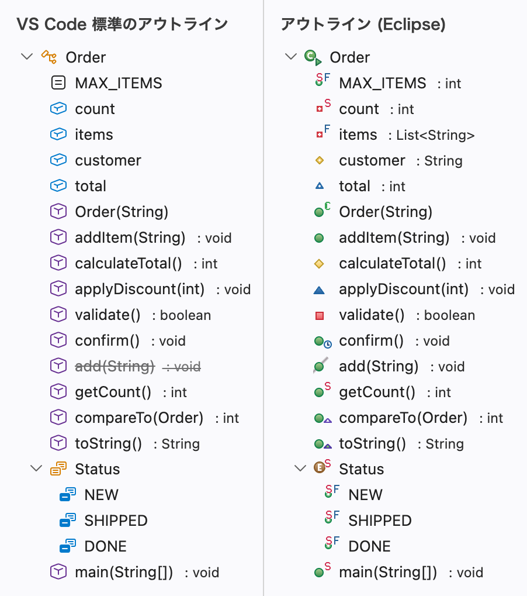

# アウトライン (Eclipse)

VS Code で Java を書くときに、クラスの中のフィールドやメソッドを、Eclipse のアウトラインと同じアイコンで一覧できる拡張機能です。

<picture>
  <source media="(prefers-color-scheme: dark)" srcset="READMEの図/比較画面-ダーク.png">
  
</picture>

上の図は、同じ Java のファイルを、左は VS Code 標準のアウトライン、右はこの拡張機能のビュー「アウトライン (Eclipse)」で出したものです。VS Code 標準のアウトラインは、メソッドならどれも同じアイコンで出すので、public か private か、static か、親の型のメソッドをオーバーライドしているかを、アイコンでは見分けられません。アウトライン (Eclipse) は、これらを Eclipse と同じアイコンで出し分けます。フィールドの名前の後ろには、型も出します。

## できること

- Java のファイルを開くと、右側のサイド バーのアウトライン (Eclipse) に、クラス・フィールド・メソッドなどが1つずつ行になって並びます。jar の中のクラス（JDK のクラスを含む）を開いたときも同じです
- エラーや警告のある行は、VS Code 標準のアウトラインと同じく、名前に色が付き、行の右端に問題の数が出ます。Eclipse と同じく、アイコンの左下にもエラー・警告アイコンが付きます。Checkstyle for Java の違反も、同じように出ます
- 操作は VS Code 標準のアウトラインと同じです。行をクリックすると、エディターのその場所へ移ります。ビューの見出しの「…」メニューで、カーソルに追従と並べ替えを選べます
- Java 以外のファイルは、VS Code 標準のアウトラインと同じように出します
- VS Code 標準のアウトラインには手を加えません。両方を並べて使えます

## アイコンの見方

アイコンは、Eclipse と同じく、可視性アイコンか型アイコンを土台にして、修飾子などを表す小さなアイコンを重ねた形です。Eclipse の画像は使わず、形と色を真似て描いています。

### 可視性アイコン（メソッドとフィールド）

左がメソッド、右がフィールドの図です。

-   public
-   protected
-   書いていない（package）
-   private

### 型アイコン

-  クラス
-  インターフェイス
-  enum
-  アノテーション型
-  パッケージ宣言

public でない型は、型アイコンの右下に、可視性を小さく付けます（形と色は、可視性アイコンと同じです）。

### 重ねるアイコン

-  abstract
-  コンストラクター
-  final
-  volatile
-  static
-  native
-  default メソッド、既定値のあるアノテーションの要素
-  synchronized
-  transient
-  main メソッドを持つ型
-  オーバーライド（親の型の、中身のあるメソッドを書き換えている）
-  実装（親の型の abstract なメソッドに、中身を与えている）
-  非推奨（`@Deprecated`、Javadoc の `@deprecated`）。名前に取り消し線は引きません
-  エラーがある
-  警告がある
-  情報がある

付け方は、Eclipse と同じです。

- 書いていない修飾子も、Java の決まりで付くものは付けます（例：インターフェイスのメソッドは public abstract、enum の定数は public static final）
- オーバーライドと実装は、`@Override` を書いたかどうかではなく、親の型に同じメソッドがあるかで決めます。コンストラクター・private・static のメソッドには付けません
- エラー・警告・情報は、その行の範囲（子の行の範囲も含む）にある問題のうち、いちばん重いものを1つ出します

## 必要なもの

- VS Code 1.140版以降
- Language Support for Java by Red Hat（`redhat.java`）

## 導入手順

Marketplace には出していないので、ファイルを置いて入れます。

1. 適当なフォルダー（例：`eclipse-like-outline`）を作り、このリポジトリの次の3つのファイルを同じ名前で置きます。中身はコピペで構いません
   - `extension.js`
   - `package.json`
   - `README.md`
2. コピペで作った場合は、VS Code でファイルを開き、右下の文字コードの表示が `UTF-8` であることを確かめてから保存します。`Shift JIS` になっていたら、そこをクリックして「エンコード付きで保存」から `UTF-8` を選びます
3. コマンド パレット（`Ctrl+Shift+P`）で「開発者: 場所から拡張機能をインストール...」（英語表示の VS Code では「Developer: Install Extension from Location...」）を実行し、手順1のフォルダーを選びます
4. 右側のサイド バーに、アウトライン (Eclipse) が開きます（開いた状態で出るのは、導入して最初の起動のときだけです）。Java のファイルを開くと、行が並びます

## うまく動かないとき

- **「Cannot find a valid extension from the location」と出る**：次の3つを確かめてください
  - `package.json` の文字コードが `UTF-8` か（`Shift JIS` で保存されると、拡張機能として読めません）
  - ファイル名が `package.json.txt` などになっていないか
  - 手順3で選んだフォルダーの直下に、3つのファイルがあるか
- **ビューが見当たらない**：右側のサイド バーが閉じているときは、`Ctrl+Alt+B`（Mac では `Cmd+Option+B`）で開きます。右側のサイド バーのタブが多いときは、タブの並びの「…」の中にあります
- **右側に出したくない**：ビューの見出しをドラッグして、好きな場所に移せます
- **Java のファイルで「シンボルが見つかりません」と出る**：Language Support for Java by Red Hat が入っているかを確かめてください。入っていれば、ステータス バーの表示が「Java: Ready」になると出ます。それでも出ないときは、ファイルを少し編集すると出ます

## 既知の制限

VS Code 標準のアウトラインや Eclipse のアウトラインと違うところのうち、使っていて気づきやすいものです。

- Language Support for Java by Red Hat の準備が終わるまで（ステータス バーの表示が「Java: Ready」になるまで）は、行を VS Code 標準のアイコンで、フィールドの型なしで出します。準備が終わると、1秒以内に Eclipse と同じアイコンに替わります
- フィールドの型とオーバーライドアイコンは、行が出てから少し遅れて付きます。ふつうは1秒以内ですが、フィールドやメソッドが数百個のファイルや、準備が終わった直後に開いたファイルでは、数秒かかることがあります
- ほかのファイルにある親のクラスを書き換えたときは、そのファイルを保存してから、オーバーライドアイコンを付け直します（Eclipse は、ビルドのたびに付け直します）
- import 宣言のまとまりと、初期化ブロックの行は出ません（Eclipse のアウトラインにはありますが、Language Support for Java by Red Hat が返さないため）
- 「…」メニューに「種類でフィルター」はありません。行を文字で絞り込むときは、ビューで `Ctrl+Alt+F`（Mac では `Cmd+Option+F`）を押して出る検索窓の「フィルター」ボタンを押します
- 行を `Ctrl`（Mac では `Cmd`）を押しながらクリックしても、横のエディター グループでは開きません（ふつうにクリックしたときと同じ動きです）
- ソースのない jar のクラス（JDK のクラスなど）では、本体のある定数（`RED { … }`）がある enum にも「F」（final）が付きます
